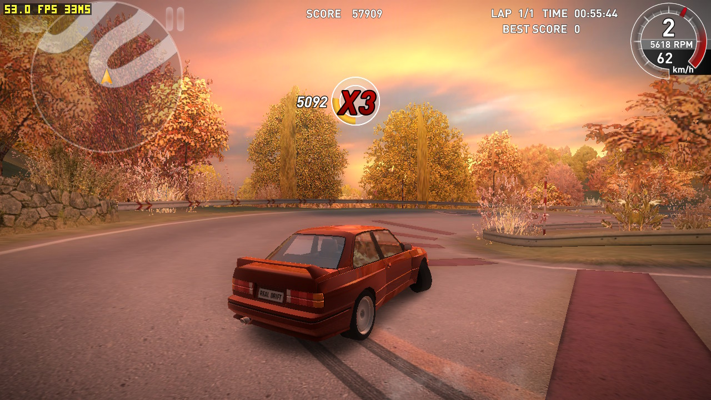

# realdrift_nx

A Nintendo Switch homebrew loader that runs the **original Android build of [Real Drift Car Racing](https://play.google.com/store/apps/details?id=com.realdrift.sipon)** (com.realdrift.sipon, Unity 2018.4, IL2CPP) natively on the console.



It does not emulate a phone and does not reimplement the game. The game's own arm64 libraries (`libunity.so`, `libil2cpp.so`, `libmain.so`) are loaded into a libnx process, and the Android environment they expect is provided by shims: bionic → newlib, the NDK, EGL/GLES via switch-mesa, OpenSL ES for FMOD audio, and a fake JNI/Java layer.

> **This repository contains no game code or assets.** You need your own copy of Real Drift. The loader reads it from the original APK and OBB on your SD card.

## Status

Playable: menus, races, sound, controller driving and saving work on hardware.

Known issues:
- heavy tire smoke can drop the frame rate (the GPU is the limit); `smoke_size` / `smoke_amount` in `config.txt` make it lighter

Limitations:
- network-related functions are obviously not supported

## Features
- **Controller driving.** Physical buttons are mapped onto the game's own throttle, brake, handbrake, gear and camera controls; analog steering comes from the left stick. Every binding can be changed in `config.txt`.
- **Separate clutch** (`Y` by default), which the original game does not have: you can now use the clutch separately (e.g. for low-powered cars).
- **Pause** on a button (`+` by default).
- **Touch driving controls hidden** during races (optional).
- **Controller menu navigation:** a frame marks the selected menu element. The D-pad or the left stick moves it to the neighbour in that direction, as with a TV remote; `A` selects, `B` goes back. `L` / `R` switch the car in the garage, the leaderboard track and the settings and profile tabs. On a slider, `A` starts editing: left / right change the value, `A` keeps it, `B` restores the old one. `A` or `B` skip the track preview before a race. The touchscreen keeps working.
- **On-screen cursor** instead of the navigation (`menu_navigation=0`): the left stick moves it, `A` taps, `+` toggles it outside a race, `-` toggles gyro pointing; a USB mouse works too.
- **Render resolution:** 720p handheld / 1080p docked by default, or fixed.
- **Lighter tyre smoke** (optional): smaller and fewer smoke puffs for a steady frame rate.
- **Faster loading:** recently read parts of the APK and OBB are kept in memory and shared by every open of them, so a part is read from the SD card once (tracks load about twice as fast). The thousands of small reads Unity makes at every start are saved once into `.realdrift_nx-reads` and served from memory on later starts, like an OS launch prefetch. Unity's il2cpp data is copied from the APK only when the APK changed, not on every start, and the game's blank 2-second splash screen is skipped.
- **No black textures:** the game's ETC2 textures, which the Switch GPU cannot read, are re-encoded to S3TC on load (on the otherwise idle CPU cores). Mesa used to unpack them to 4–8 times the memory, so after many cars and tracks new objects turned black.
- **Steady sound:** the audio output runs on its own thread over libnx `audout`. SDL's Switch audio could stop for good when a load kept its thread off the CPU, leaving the game silent until restart.
- **FPS counter** (optional) in the top-left corner.
- **Saves** are stored on the SD card (`prefs.kv` next to the game).
- No per-version offsets: engine patch sites are found at runtime by instruction patterns, and game classes are found by name through the IL2CPP API.

## Supported game version

| | |
|---|---|
| Game | Real Drift (full version), package `com.realdrift.sipon` |
| Version | **5.0.8**, versionCode **76**, arm64-v8a |
| Files | `base.apk` + `main.76.com.realdrift.sipon.obb` (~230 MB) |

Other versions do not work as is. Real Drift Lite (`com.realdriftportnew.sipon`) is not supported. The version is defined in one place, [`source/game/rd_game.h`](source/game/rd_game.h).

## Installing

You need a Switch with homebrew (Homebrew Menu), a PC with Python 3.8+, and Real Drift **5.0.8** installed on an Android phone and started at least once (the first start downloads the OBB).

**1. Download** `realdrift_nx-vX.Y.Z.zip` from [Releases](../../releases) and unpack it. It contains `realdrift_nx.nro`, `stage_sd.py` and `config.example.txt`.

**2. Copy two files from the phone** into the unpacked folder:

| File | Location on the phone |
|---|---|
| `base.apk` | `/data/app/…/com.realdrift.sipon-…/base.apk` (`adb shell pm path com.realdrift.sipon` prints the exact path) |
| `main.76.com.realdrift.sipon.obb` | `/sdcard/Android/obb/com.realdrift.sipon/main.76.com.realdrift.sipon.obb` |

With [adb](https://developer.android.com/tools/releases/platform-tools) and USB debugging enabled: `adb pull <path> .`

**3. Run the script** in that folder:

```sh
python3 stage_sd.py base.apk main.76.com.realdrift.sipon.obb
```

It checks that both files are the supported version, takes the three game libraries out of the APK and creates `switch/realdrift_nx/`:

```
switch/realdrift_nx/
├── realdrift_nx.nro
├── libmain.so  libunity.so  libil2cpp.so
├── base.apk
└── main.76.com.realdrift.sipon.obb
```

The loader adds a few files of its own there at run time: `config.txt`, `prefs.kv` (saves), `il2cpp/` (Unity's data copied from the APK) and `.realdrift_nx-reads` (the start-up prefetch, about 120 KB). Deleting `il2cpp/` or `.realdrift_nx-reads` is safe; they are recreated on the next start.

**4. Copy the `switch` folder to the root of the SD card** and start *Real Drift* from the Homebrew Menu in title-takeover mode (hold `R` while starting any game). Applet mode (from the Album) has not been tested and most likely does not give the game enough memory.

## Controls and configuration

`config.txt` is created in the game folder on first launch. See [`config.example.txt`](config.example.txt) for every key, its default and a description.

### Controls

Each `bind_*` key accepts one or more of `A B X Y L R ZL ZR PLUS MINUS UP DOWN LEFT RIGHT LSTICK RSTICK`, comma separated, or `NONE` to unbind. The left stick always steers.

| Key | Default | Meaning |
|---|---|---|
| `bind_throttle` | `ZR` | throttle |
| `bind_brake` | `ZL` | brake |
| `bind_handbrake` | `B` | handbrake (the game also disengages the clutch while it is held) |
| `bind_clutch` | `Y` | clutch, fully pressed while held |
| `bind_gear_up` | `UP` | shift up |
| `bind_gear_down` | `DOWN` | shift down |
| `bind_camera` | `NONE` | switch the camera view |
| `bind_steer_left` | `LEFT` | steer left (when the left stick is centred) |
| `bind_steer_right` | `RIGHT` | steer right (when the left stick is centred) |
| `bind_pause` | `PLUS` | pause / resume the race (also closes the pause menu) |
| `stick_deadzone` | `0.15` | left stick deadzone, `0.0`–`0.9` |

### Menus

| Key | Default | Meaning |
|---|---|---|
| `menu_navigation` | `1` | `1` = controller navigation with a focus frame (no cursor); `0` = the on-screen cursor |
| `bind_ui_select` | `A` | select the focused element; start / finish editing a slider; skip the track preview |
| `bind_ui_back` | `B` | go back; cancel slider editing; skip the track preview |
| `bind_ui_prev` | `L` | previous car in the garage, tab, leaderboard track |
| `bind_ui_next` | `R` | next car in the garage, tab, leaderboard track |

### Performance

| Key | Values | Default | Meaning |
|---|---|---|---|
| `render_resolution` | `auto` / `720` / `1080` | `auto` | `auto` = 720p handheld, 1080p docked |
| `boost_loading` | `0` / `1` | `1` | raise the CPU clock at start and while a scene loads |
| `archive_cache` | `0` / `1` | `1` | keep recently read parts of the APK and OBB in memory (64 MB) and prefetch the small reads made at start; `0` reads the SD card directly (slower loads) |
| `fast_boot` | `0` / `1` | `1` | copy Unity's il2cpp data from the APK only when the APK changed, and skip the blank Unity splash screen; `0` = as the original game |
| `texture_transcode` | `0` / `1` | `1` | store the game's ETC2 textures as S3TC, which the GPU reads directly; `0` leaves them to Mesa, which unpacks them to 4–8x the memory, and after many cars and tracks new objects show black |
| `smoke_size` | `10`–`100` | `100` | size of the tyre smoke puffs in percent; `100` = original. Lower it (e.g. `50`) if heavy smoke drops the frame rate |
| `smoke_amount` | `10`–`100` | `100` | percent of the smoke puffs emitted; `100` = original. `50` together with `smoke_size=50` keeps the frame rate steady in heavy smoke |

### Debugging

| Key | Values | Default | Meaning |
|---|---|---|---|
| `debug_log` | `0` / `1` | `0` | `1` = full `debug.log` for bug reports; `0` = only crashes, stalls and startup |
| `debug_fps_counter` | `0` / `1` | `0` | show frames per second and the slowest frame (ms) in the top-left corner |
| `debug_gl_trace` | `0` / `1` | `0` | log where a frame's GPU time goes, per render target, about every 10 s (with `debug_log=1`) |
| `debug_ui_nav` | `0` / `1` | `0` | log what menu navigation finds on each screen, what it skips and why, and every move (with `debug_log=1`) |
| `debug_mem` | `0` / `1` | `0` | log where the memory is about every 10 s and after each load, and every GL error when a texture or buffer is created (with `debug_log=1`) |
| `debug_load` | `0` / `1` | `0` | for every frame of a second or more (a load): the file traffic the engine asked for against what reached the SD card, cache hits, writes, the time since start, and each engine thread's CPU time (with `debug_log=1`) |
| `debug_audio` | `0` / `1` | `0` | log when the sound goes silent for 3 s or comes back, when the audio output stops, and the game's volume / mute calls (with `debug_log=1`) |

### Other

| Key | Values | Default | Meaning |
|---|---|---|---|
| `hide_touch_controls` | `0` / `1` | `1` | hide the on-screen driving buttons in races |

When reporting a problem, set `debug_log=1`, reproduce it and attach `sdmc:/switch/realdrift_nx/debug.log`.

## Building

The build uses the official devkitPro Docker image, which already contains every library needed (libnx, switch-mesa, SDL2, libpng, zlib):

```sh
docker run --rm -u $(id -u):$(id -g) -v ./:/project -w /project devkitpro/devkita64:latest make
# -> realdrift_nx.nro
uv run python tools/stage_sd.py original/base.apk original/main.76.com.realdrift.sipon.obb \
    --nro realdrift_nx.nro --out sd/switch/realdrift_nx      # SD folder from a source build
```

## Development

```sh
make test             # all unit tests: Python tools + host-side C tests (ASan/UBSan)
make tools            # build-host/find_patch_sites: run the loader's pattern finders on .so files
make config-example   # regenerate config.example.txt from the settings table
make lint             # ruff + mypy for the Python tools
make coverage         # tests with line coverage (C + tools/), HTML in build-host/coverage/
```

These targets need a host C compiler and uv, not devkitPro. Tests that need extracted game libraries in `analysis/` are skipped when those are missing.

| Path | Contents |
|---|---|
| `source/` | the loader, one directory per layer: `loader`, `bionic`, `android`, `engine`, `platform`, `game` (see [docs/ARCHITECTURE.md](docs/ARCHITECTURE.md)). Our modules are `rd_*`. Named values live in one place: `rd_game.h` (game identity and files), `rd_game_symbols.h` (C# names), `rd_platform.h`, `rd_device.h`, `rd_settings.c` (config keys) |
| `tools/` | `stage_sd.py`, `release.py` (release package), `game.py`, `import_coverage.py`, `jni_natives.py`, `il2cpp_symbolize.py`, `find_patch_sites.c` |
| `.github/workflows/ci.yml` | on every push / pull request: lint, tests with coverage floors, the Switch build |
| `.github/workflows/release.yml` | on a `vX.Y.Z` tag: builds the `.nro`, runs the tests, publishes the release zip |
| `tests/` | pytest suite; `tests/c/` host-side C unit tests |
| `docs/` | [architecture](docs/ARCHITECTURE.md), [C style](docs/CODING_STYLE.md), [Python style](docs/PYTHON_STYLE.md) |

Game files (`original/`, `analysis/`, `sd/`) are git-ignored. Never commit them.

To publish a release, push a version tag: `git tag v1.0.0 && git push origin v1.0.0`.

## License

The loader is released under the **MIT License**, see [LICENSE](LICENSE). Files that come from other projects keep their original copyright notices (also MIT).

Real Drift and all of its files (code, assets, `.so` libraries, APK, OBB) belong to their respective owners. They are not covered by this license, are not included here, and must not be redistributed. This project is not affiliated with or endorsed by the developers of Real Drift or by Nintendo.

## Credits

**Loader base** (code included in `source/`, MIT):

| Project | Authors | Used for |
|---|---|---|
| [badpiggies_nx](https://github.com/ChanseyIsTheBest/badpiggies_nx) (commit `7726be3`) | ChanseyIsTheBest | the forked base: Unity/IL2CPP loader, fake JNI, libc/NDK shims, the OpenSL ES shim (its output now runs over libnx `audout`), pointer and touch input, fonts, diagnostics |
| [cloverpit_nx](https://github.com/ChanseyIsTheBest/cloverpit_nx) | ChanseyIsTheBest | MIT license of the pointer/cursor module (`nx_pointer`, the GL overlay in `rd_overlay_gl.c`), the same code as in badpiggies_nx |
| [laytonbmr_nx](https://github.com/NaGaa95/laytonbmr_nx) | naga | the stick cursor and its GL overlay, which badpiggies_nx ported |
| [colorsheep_nx](https://github.com/ChanseyIsTheBest/colorsheep_nx), [zookeeperdx_nx](https://github.com/ChanseyIsTheBest/zookeeperdx_nx) | ChanseyIsTheBest | the so-loader port lineage badpiggies_nx descends from |
| [vln_nx](https://github.com/NaGaa95/vln_nx), [cr3_nx](https://github.com/NaGaa95/cr3_nx) | naga | the so-loader port lineage badpiggies_nx descends from (cr3_nx: the OpenSL ES shim and fake fds) |
| so-loader (Android game ports to Vita/Switch): [gtasa_vita](https://github.com/TheOfficialFloW/gtasa_vita), [max_nx](https://github.com/fgsfdsfgs/max_nx) | Andy Nguyen (TheFloW), fgsfds, Rinnegatamante | ELF loading and relocation (`so_util.c`), import table (`imports.c`), `util.c`, `error.c` |

**Algorithms:** menu navigation follows the rules of Android's [FocusFinder](https://android.googlesource.com/platform/frameworks/base/+/refs/heads/main/core/java/android/view/FocusFinder.java) (AOSP, Apache-2.0); the code is our own.

**Libraries included** (in `source/android/third_party/`, used for the texture re-encoding):

| Library | Authors | License |
|---|---|---|
| [etcdec](https://github.com/iOrange/etcdec) v0.91 (commit `972875d`) | Sergii "iOrange" Kudlai | MIT or Unlicense |
| [stb_dxt](https://github.com/nothings/stb) v1.12 (commit `003501f`) | Fabian "ryg" Giesen, Sean Barrett | MIT or public domain |

**Libraries linked into the `.nro`** (from devkitPro, not in this repository):

| Library | License |
|---|---|
| [libnx](https://github.com/switchbrew/libnx) ([devkitPro](https://devkitpro.org)) | ISC |
| [Mesa](https://mesa3d.org) for Switch (GLES/EGL), libdrm_nouveau | MIT |
| [SDL2](https://libsdl.org) (game controllers) | zlib |
| [libpng](http://www.libpng.org) | libpng license |
| [zlib](https://zlib.net) | zlib |

**Development tools** (not part of the build): [pyelftools](https://github.com/eliben/pyelftools), [UnityPy](https://github.com/K0lb3/UnityPy), [pytest](https://pytest.org), [uv](https://github.com/astral-sh/uv), and [Il2CppDumper](https://github.com/Perfare/Il2CppDumper) for research.
